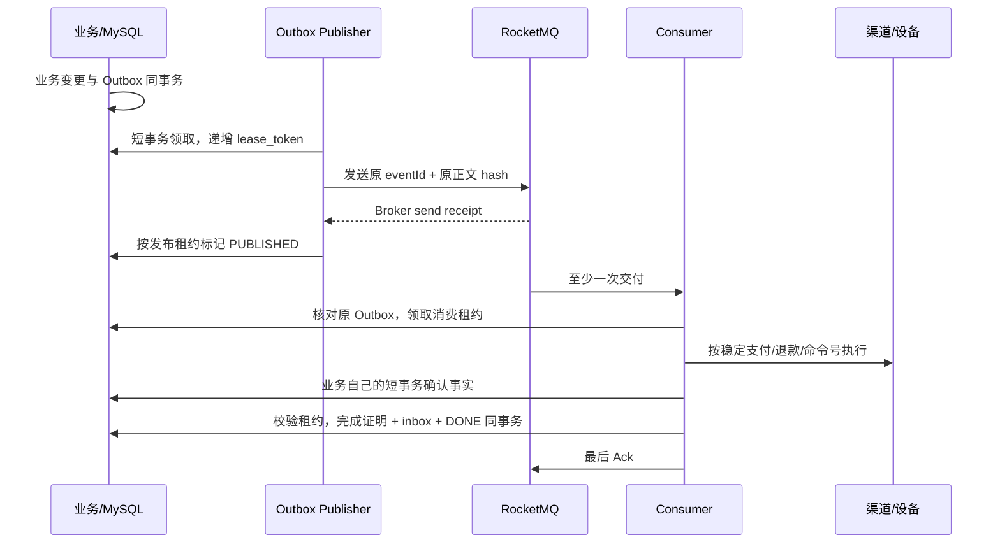

# ADR-002：保留数据库 Outbox，按需接入 RocketMQ 5 原生客户端

状态：已实施；故障验收结果以实际生成的 `.local/reports/mq.json` 为准。

日期：2026-10-19。

## 决策与版本

默认 `chargehub.messaging.mode=db` 继续运行短租约数据库 Worker。`rocketmq` 模式使用 Apache 原生 `rocketmq-client-java:5.2.2`，通过 Broker 的 LOCAL gRPC Proxy 发送和接收消息，不引入第三方 Spring Starter。所有模式仍先将业务意图写入数据库 Outbox。

Broker 固定为官方 `apache/rocketmq:5.5.0@sha256:7e8f6c9dbd9df742ed26ba69c00d4ad69e2f86a56f3ca7782ff8144dd0798132`。审阅时 GitHub 已发布 5.5.1 源码，但官方 Docker 5.5.1 标签实际拉取返回 `manifest unknown`；因此没有把未验证的镜像填入配置。5.5.0 镜像与 5.2.2 客户端已执行真实独立发送、接收、正文比对和 Ack。它们是本项目经过验证的组合，不代表任意 5.x 组合均可兼容。

原生示例和 Broker 配置的固定源码链接见 [消息实现参考审阅](../references/messaging-review.md)。客户端 Maven SHA-1 与本项目额外固定的 SHA-256 在 `scripts/mq-smoke.py` 中核验；Docker 使用不可变镜像 digest。

## 事务边界



没有覆盖网络调用的数据库长事务，也没有将发送 Broker 与更新 MySQL 宣称为原子操作。消费 handler 现有业务服务包含多个独立短事务；完成证明、`consumer_inbox` 和消息状态在**后续同一个短事务**提交，不代表之前所有业务事务均与 inbox 原子提交。

如果业务事实已提交、但完成证明尚未提交就崩溃，handler 会再次执行。安全性来自渠道/设备的稳定业务号、不可变资金流水的业务唯一键、退款额度事务和订单状态机；不是来自一个提前写入的 inbox 标记。`MessagingCompletionProof` 只读取已持久化的订单、资金、会话、账单或补传结果。未能证明完成时不写 inbox、不 Ack。

## 状态与重放

| 数据 | 状态与用途 |
| --- | --- |
| `outbox_event` | READY → PROCESSING → PUBLISHED → DONE；发布失败可回 READY，受限失败转 DEAD。原 eventId、事件名、聚合版本、载荷和时间构成运输正文。 |
| `outbox_publication` | 保存 Broker receipt、稳定正文 hash 和发送次数；是发送证据，不是业务完成证明。 |
| `message_delivery` | 领取消费租约并递增 token；RETRY 可重新领取；COMPLETED 保存本地完成证明；DEAD 保存有界消费失败。 |
| `consumer_inbox` | 仅完成证明事务成功后写入；重复交付看到已完成记录即可 Ack，无需再次执行 handler。 |
| `message_ack_evidence` | 仅实际 Broker Ack 成功后保存 deliveryAttempt/是否重复；属于可观测性，不能替代 Broker Ack。缺少记录时不能反推 Ack 已成功。 |
| `message_quarantine` | 未知事件、非法版本、错误 UTF-8、篡改正文或不匹配的 Broker metadata 只保存消息号、hash 和错误分类，然后终止无效消息的重复处理。 |

消费前、完成前以及失败回写前均核对原数据库 Outbox 的完整 envelope hash；没有只相信消息自身携带的 hash。消费和发布均使用短租约与 token 条件更新。长 handler 在独立 heartbeat 线程中每个租期的三分之一续租，同时延长 Broker 可见性；续租也校验原正文、当前 owner/token 和尚未过期的租约，不能复活已过期持有者。handler 返回后先关闭 heartbeat，保证不再发生后台续租，再提交完成证明。进程被杀死时 heartbeat 一起停止，任务仍可自然过期接管。过期进程不能确认新持有者的工作，但租约不能撤回已经发出的网络请求，所以外部稳定业务号仍是必要条件。

普通业务失败默认三次本地处理后，同时将 delivery 与源 Outbox 标记 DEAD。失败消息不 Ack，Broker 按消费组 `retryMaxTimes=4` 继续执行可见性与物理死信策略。物理 `%DLQ%chargehub-workflow-v1` 与应用 DEAD 列表分别核验，不把数据库 DEAD 当成 Broker 已进入 DLQ 的证据。

管理员通过现有 `POST /v1/admin/outbox/{eventId}/replay` 提交原因。API 和 Worker 都应配置 `mode=rocketmq`；重放事务重置 DEAD 消费任务并提升 token，保留原 eventId、载荷和 hash。重新发送会得到新的 Broker messageId，逻辑 eventId 保持不变。历史 Broker DLQ 和操作审计保留，不通过修改现金、账单或消息原文“修复”任务。

## 开发部署与故障入口

```bash
docker compose -f compose.yaml -f compose-mq.yaml --env-file .local/dev.env up -d --no-build
python3 scripts/mq-smoke.py
python3 scripts/mq-faults.py
```

`compose-mq.yaml` 提供 NameServer、Broker 与 LOCAL Proxy、显式 Topic/消费组初始化；只有专属卷初始化任务以 root 为 UID 3000 准备卷目录，Broker 始终以镜像的非 root 用户运行。Broker 配置 `SYNC_FLUSH`，本地模式不提供副本容灾。开发 gRPC 明文传输仅用于私有 Compose 网络；应用客户端默认启用 TLS，真实部署须配置可验证的 TLS、身份凭据、网络边界、配额和多节点容灾。

故障脚本需要最新应用镜像、V7/V8、完整 MQ 拓扑和一次已完成退款的正常演示。它会暂停普通 Worker，创建专用 fault Worker，在实际 barrier 被数据库观察到后执行外部 `docker kill --signal=KILL`，最后恢复原 Worker 数量。不得与其他修改模拟器故障配置的验收并发执行。

| 场景 | 脚本实际验证内容 |
| --- | --- |
| A40 | Broker 已接受但发布标记尚未保存时杀 Publisher；过期租约恢复后按原 eventId 再次发送，真实接收、完成与 Ack，资金副作用仍只有一笔。 |
| A41，业务提交至 inbox 前 | 通过 API 新建普通用户订单、独立设备生成真实计量和首笔退款；首次退款提交后杀 Consumer；原消息重投再次执行而不增加退款/会话。 |
| A41，inbox 提交至 Ack 前 | 另一笔新订单在完成证明与 inbox 提交后、Ack 前被杀；重投从 inbox 去重并记录真实重复 Ack，不能仅凭之前 DONE 就算通过。 |
| A42 | 对合法退款事件注入 dev-only 有界失败，实际查询 Broker 物理 DLQ；移除故障，通过 ADMIN API 按原 eventId 审计重放，保持原载荷 hash 和资金事实。 |

Failpoint 只允许 `dev`/`test`，必须绑定具体 eventId，或指定订单 UUID 加白名单事件名；没有生产控制接口。正常配置全部关闭。测试创建的普通用户和模拟交易保留作证据，不篡改或清空现有资金事实。

真实结果写入 `.local/reports/mq-native-smoke.json`、`mq-native-smoke.log`、`mq.json`；数据库语义由 `MessageMysqlTest` 补充验证。若脚本失败，报告保留已观察到的场景和失败步骤，未完成的场景不能标记通过。系统提供至少一次交付和业务幂等，不承诺网络消息恰好投递一次或跨系统事务原子性。
