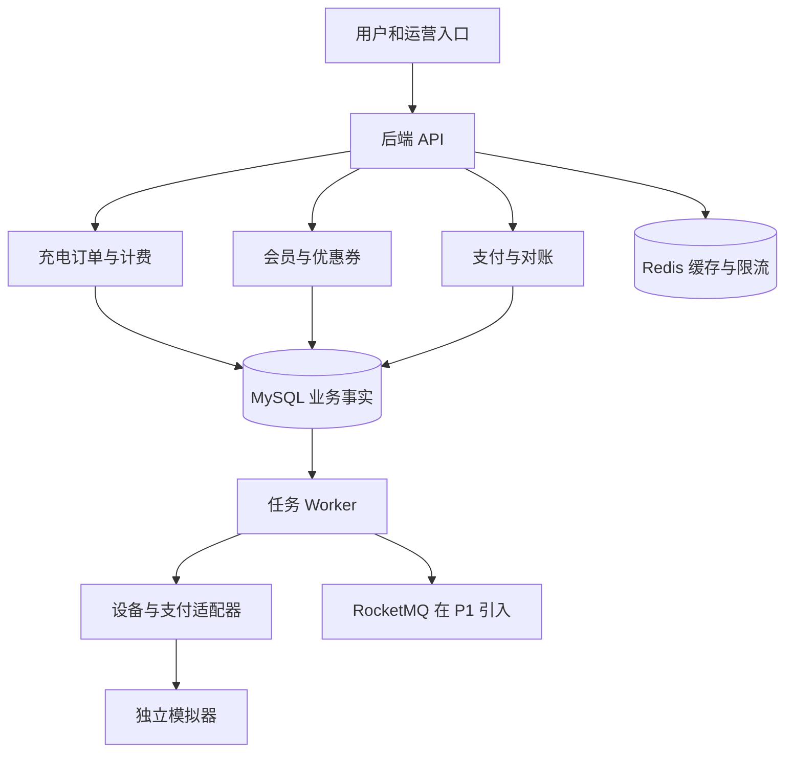

# 充电交易与会员权益平台后端实施项目书

ChargeHub 版本 1.0

基准日期 2026 年 10 月 18 日

## 1 项目结论与交付目标

建设一个面向新能源充电业务的后端平台，将充电订单、预付款、分时计费、会员服务费折扣、优惠券、余额退款和渠道对账组成完整链路。用户能够领取权益、选择充电枪、预付费用、启动模拟充电、查看费用明细并收到剩余预付款退款；运营人员能够配置费率和活动，财务人员能够查看支付事实与对账差异。

项目第一版采用 Java 模块化单体、单个 MySQL 数据库和独立模拟设备及模拟支付服务。先用本地事务保障订单与权益的一致性，再引入异步事件、重复投递和故障恢复。首版达到可部署试用和可复现验收的标准，后续是否拆分微服务由实际压测与维护需求决定。

交付成果包括源码、数据库迁移、核心接口文档、独立模拟器、演示脚本、业务测试、故障演练、压测报告和部署回滚手册。本项目的实际贡献以代码、提交、测试与试用反馈为依据；项目名称不代表任何车企委托、雇佣或背书。

### 1.1 可演示结果

- 用户完整完成一次预付 100 元、充电 20 kWh、使用会员折扣和优惠券、最终消费 21 元并退款 79 元的流程。
- 相同支付通知重复 20 次，支付流水、启动指令和权益消耗均只产生一次有效业务结果。
- 消息投递后进程被杀死，重启后能够恢复执行，并用相同业务编号向外部重试。
- 设备启动结果未知时保留枪和权益，不把超时直接作为启动失败。
- 对账能发现漏通知、金额不一致、退款未完成，并给出可审计处理记录。

### 1.2 首版与进阶范围

| 阶段 | 必须交付 | 完成标志 |
| --- | --- | --- |
| P0 业务闭环 | 预付充电、单券、会员月度次数、计费、差额退款、数据库任务和模拟器 | 所有 P0 验收通过，空库可一键启动 |
| P1 可靠性与展示 | RocketMQ、死信重放、对账导入、指标监控、简洁演示页面和两实例部署 | 故障矩阵通过，形成实测报告 |
| P2 按目标岗位选做 | 独立营销服务、真实支付沙箱适配或 OCPP 适配三选一 | 新旧行为对照与迁移说明通过 |

首版不包含储值钱包、商户分账提现、真实设备安全控制、全国运营商互联、积分抵现、多个优惠券叠加、会员付费续订和完整会计总账。这里的结算指订单费用确认、剩余预付款退款与渠道对账。

## 2 企业实践与开源参考

蔚来公开的扫码充电服务规则体现了预付充电、服务结束后的费用处理以及第三方设备运营方等业务边界。[S01] 本项目据此采用预付款模型，具体价格、退款规则和会员优惠均是本项目自己的明确约定，不声称复刻蔚来内部系统。

美团公开的订单系统演进文章讨论了交易资源预占、重试、幂等和故障治理；其可靠性治理文章进一步介绍了唯一约束与条件更新等幂等手段。[S02][S03] 本项目使用这些方法处理付款、权益和设备指令的边界。两篇文章是历史实践资料，文中当时的中间件与性能数字不作为本项目选型或实测结果。

| 来源 | 阅读重点 | 本项目采用方式 |
| --- | --- | --- |
| 芋道 ruoyi-vue-pro | member、promotion、pay 模块与优惠券开发指南 | 借鉴模块边界、券模板与用户券区分、支付通知职责；核心业务自行实现 [S04][S05] |
| macrozheng mall | 订单确认、优惠计算、超时关单与权益恢复源码 | 对照研究订单与营销联动，不能直接照搬电商超时关单到正在充电的订单 [S06] |
| SteVe | 充电站、会话、设备通信与 OCPP 接入边界 | 协议研究与可选独立联调参考；不把其源码合并进本项目 [S07] |
| Open Charge Alliance | OCPP 的职责与版本边界 | 将自定义模拟协议与真实 OCPP 适配隔离 [S08] |

芋道仓库标注 MIT，mall 标注 Apache 2.0，SteVe 标注 GPL 3.0，具体复用需逐文件核对许可证并保留要求的声明。SteVe 当前主分支说明要求 JDK 25，本项目使用 Java 21，两者不直接合并构建。参考分支、实际阅读的提交 SHA 和复用内容在 T00 记录，资料包不固定未经验证的源码提交。

## 3 使用角色与需求

| 角色 | 可执行操作 | 必须限制 |
| --- | --- | --- |
| 普通用户 CUSTOMER | 查询站点、领券、创建自己的订单、支付、停止、查看账单退款 | 不能传任意用户编号代替当前身份，不能修改应付金额 |
| 运营 OPS | 配置站点、发布新费率版本、发布券模板、查看受限订单 | 已发布规则不原地改历史数据；不能直接修改资金事实 |
| 财务 FINANCE | 导入渠道对账单、查看差异、重试符合条件的退款 | 重试沿用原退款编号，操作必须记录原因 |
| 管理员 ADMIN | 授予角色、配置演示环境 | 生产不使用示例密码，模拟入口不暴露公网 |
| 设备模拟器 | 接收指令、上报会话和计量事件 | 只能操作分配给自己的设备与会话 |
| 支付模拟器 | 创建交易、成功付款、查询、关闭、退款、生成账单 | 必须独立保存渠道事实，支持故意丢通知 |

订单数据权限由服务端按当前用户和角色检查。管理员授权也经过审计；“有订单号”不构成查看或修改订单的权限。

## 4 固定业务规则

以下规则是首版的验收口径，变更必须先更新规则、示例、状态和测试，再修改代码。

| 编号 | 规则 |
| --- | --- |
| B01 | 一个用户同时最多存在一笔占用资源的充电订单，一把枪同时最多绑定一笔订单。CANCELING、START_PENDING、STOP_PENDING、EXCEPTION 仍可能占用资源。 |
| B02 | 首版固定实际预付 10000 分，不是信用卡预授权，也不是平台钱包余额。支付金额始终由服务端订单读取。 |
| B03 | 支付期限为创建后 5 分钟，到期查单并关单。截止后付款仍记资金事实并全退，不启动；不能仅凭本地时钟把支付记为失败。 |
| B04 | 费率由电费和服务费组成，以整数分每 kWh 表示；电量为整数 Wh；本项目不收停车费和占位费。 |
| B05 | 费率版本在订单创建时固定。版本内每天的时段覆盖 0 至 1440 分钟，使用左闭右开区间，不允许空档或重叠。 |
| B06 | 按站点业务时区 Asia/Shanghai 划分费率时段，持久化时间统一 UTC。订单跨日或跨月仍使用其已固定规则。 |
| B07 | 优惠仅抵扣服务费，不抵电费；先会员折扣，再一张优惠券。优惠后服务费不得小于零。 |
| B08 | 演示会员每月有 2 次服务费八折权益，每次优惠上限 300 分。资格在创建订单时校验并预占，归属月份固定为创建时的业务年月。 |
| B09 | 只有实际会员优惠大于零才消耗该次权益；无充电或服务费为零时释放。已开充订单不因跨月或会员自然到期失去已预占资格。 |
| B10 | 每个券模板每用户最多领取一张。发行库存只统计已发出的券，用户券过期或取消订单不增加模板发行库存。 |
| B11 | 券有效性在下单预占时判断；支付并启动须在订单既定启动窗口内。进入有效会话后，自然过期不撤销该订单已经预占的券。 |
| B12 | 用户券预占后不可用于其他订单。最终不满足门槛时释放；释放时已过有效期则成为 EXPIRED，否则恢复 AVAILABLE。 |
| B13 | 启动截止时间为渠道确认付款时间加 2 分钟。回调晚到且已过截止时间，不再首次启动；确认无会话后全退。设备返回超时属于结果未知，必须查询会话，不直接退款和放枪。 |
| B14 | 只在设备明确拒绝且无活动会话，或权威查询确认未启动时，走启动失败取消与全额退款。 |
| B15 | 正常充电按优惠前的累计费用设置预付款止损阈值，模拟器在达到上限前停止。对真实计量超额不静默抹平，进入 SHORTFALL 差异，首版由人工处理。 |
| B16 | 同一订单首版只生成一张不可变账单。计量缺口或异常未解决时不出正式账单；后续纠错使用修正单设计，不能直接覆盖历史账单。 |
| B17 | 正常退款为预付款减最终应付金额；启动失败或未开始服务取消时全额退款。支付、退款事实分别记录。 |
| B18 | 差额退款不退回已正常使用的优惠券或会员次数。首版不支持服务完成后任意部分售后退款。 |
| B19 | COMPLETED 代表服务和账单完成，退款可能仍在处理中。只有渠道净收款等于账单应付且无未决差异，财务状态才为 CLOSED。 |
| B20 | 所有设备、支付回调和任务都按可能重复、乱序或丢失设计。任何终态通知也不能抹掉已记录的真实支付成功事实。 |

## 5 端到端流程与金额样例

### 5.1 正常交易

用户先查看费率与可用权益，再创建订单。创建事务同时绑定用户和枪、保存费率与优惠规则快照、预占会员次数与用户券。支付订单创建后通过异步任务调用模拟渠道；渠道成功通知入库后，生成具有固定 commandId 的启动任务。设备确认开始会话后持续上报计量，用户停止或达到预付止损阈值后结束会话。

后台只在计量完整时生成账单，确认权益消耗并创建余额退款单。退款异步执行；查询结果与通知都进入同一资金事实处理入口。对账发现未收到通知的渠道成功记录时补录事实，再按同一规则推动后续流程。

### 5.2 必须复现的金额样例

| 项目 | 规则或结果 |
| --- | --- |
| 电量 | 20000 Wh 即 20 kWh |
| 电费单价 | 80 分每 kWh，电费 1600 分 |
| 服务费单价 | 50 分每 kWh，服务费 1000 分 |
| 会员折扣 | 服务费八折，优惠 200 分，未超过 300 分上限 |
| 优惠券 | 会员优惠后的服务费满 500 分减 300 分 |
| 最终应付 | 1600 加 1000 减 200 减 300 等于 2100 分 |
| 预付款与退款 | 已付 10000 分，退款 7900 分，渠道净收 2100 分 |

界面可以显示元，但存储、接口和账务计算使用分。接口说明和变量名必须带单位，禁止把 21 元传成 21 分。

### 5.3 计费精度与跨时段规则

每个费率分段分别计算电费和服务费，计算过程使用 BigDecimal，按 HALF_UP 舍入到整数分后累加。会员优惠等于服务费乘以 20%，舍入到分，再取单次上限；优惠券针对会员优惠后的服务费判断门槛。该顺序在所有报价、正式计费和对账校验中一致。

模拟设备必须在会话开始、费率分界点、跨日和结束时提供累计电表值。相邻边界累计 Wh 之差归入对应费率段。普通采样用于展示和止损；缺少边界采样时不按时间简单均摊实际电量，而是保持 BILLING 或进入 REVIEW，等待补传。异常累计值下降、样本冲突或停止终点缺失均进入计量异常记录。

报价接口只做基于预计电量的估算，不占枪、不锁券、不承诺实际总费用。正式创建必须再次校验资源与费率版本；正式账单由已确认计量生成。

## 6 架构与模块边界

### 6.1 技术基线

| 类别 | 选择 | 原因 |
| --- | --- | --- |
| 语言和构建 | Java 21 LTS 与 Maven Wrapper | 减少开发环境差异，构建版本进入仓库 |
| Web 与数据 | Spring Boot 4.1 系列、Spring Security、MyBatis Starter 4.0 系列、Flyway | 当前主线使用同代组件；Java 21 与 MyBatis 兼容范围已核对 [S09][S12] |
| 数据库 | MySQL 8.4 LTS，InnoDB，utf8mb4，UTC | 唯一约束、条件更新、行锁和任务领取；不能用 H2 替代并发验收 |
| 缓存 | Redis，具体稳定补丁版本在 T00 固定 | 用于站点展示、非事实缓存和限流；不作为资金和权益唯一事实源 |
| 异步 | P0 数据库 Outbox 与 Worker；P1 RocketMQ 5 系列原生 Java 客户端 | 先验证业务；不依赖未经兼容验证的第三方 Boot Starter [S10] |
| 测试与监控 | JUnit、Testcontainers、WireMock 或独立模拟器、Micrometer、Prometheus | 验证真实数据库语义并保留运行证据 |
| 部署 | Docker Compose，API 和 Worker 使用不同 profile | 单机可演示，P1 可运行两个 Worker 观察并发领取 |

T00 锁定 BOM、容器镜像 digest、JDK 补丁和 Maven Wrapper，并做兼容性烟测。资料包未指定未测试的依赖补丁号。开源参考中的 Spring Boot 2 或 3 示例只用于研究业务，不直接混入本项目的 Spring Boot 4 配置。未来升级需要 ADR 与同一验收集，不使用预览版作为交付基线。

### 6.2 Maven 模块

| 模块 | 拥有的数据与责任 |
| --- | --- |
| chargehub-identity | 账号、角色、目标用户权限、当前活动订单标记 |
| chargehub-station | 站点、枪、费率版本与时段 |
| chargehub-charging | 订单、设备指令、会话、计量与正式账单 |
| chargehub-benefit | 会员月度次数、券模板、用户券、预占与权益流水 |
| chargehub-payment | 支付单、渠道适配、退款单、资金事实 |
| chargehub-reconcile | 对账批次、差异项、补单与人工审核记录 |
| chargehub-infrastructure | Outbox、消费去重、任务领取、审计与幂等请求 |
| chargehub-app | HTTP 入口、配置装配、定时任务入口和运行 profile |

模块只能通过对方 application 接口使用能力，不跨模块直接写表。P0 允许这些接口加入同一个 REQUIRED 本地事务，跨模块不等于跨进程。公共包仅放编号、时间、金额和错误协议，不放所有业务实体。P2 如拆营销服务，必须重新设计权益预占协议和补偿，不把原本的本地事务误称为分布式事务。

## 7 状态机与资源释放

### 7.1 充电订单状态

| 状态 | 进入条件 | 后续处理 |
| --- | --- | --- |
| WAIT_PAY | 资源与权益预占成功 | 支付成功后 START_PENDING；主动取消或到期进入 CANCELING |
| CANCELING | 已请求取消，正在确认支付与设备事实 | 支付成功则记录并全额退款，禁止再启动；确认无会话后 CANCELED |
| START_PENDING | 支付成功并已创建启动任务 | 确认设备会话后 CHARGING；明确未启动则取消并退款；未知则 EXCEPTION |
| CHARGING | 设备确认会话已开始 | 用户停止或止损触发 STOP_PENDING |
| STOP_PENDING | 已持久化停止指令 | 设备确认终止后 BILLING；未知则 EXCEPTION 并继续查询 |
| BILLING | 会话结束，收集最终计量 | 数据完整则生成账单并 COMPLETED；异常则 REVIEW |
| REVIEW | 计量冲突、缺失或计费无法确认 | 补传或人工确认后回到 BILLING，不直接填写猜测金额 |
| EXCEPTION | 启动或停止结果未知 | 权威查询恢复对应状态，保持可能占用的资源 |
| COMPLETED | 正式账单已生成，权益已确认 | 退款与对账独立继续；设备确定空闲后释放枪 |
| CANCELED | 确认未发生服务或服务电量为零且取消已确认 | 释放权益和绑定，资金退款可继续处理中 |

取消与支付回调都先锁相同订单并检查状态。支付成功发生在取消之后也必须记录成功资金事实，并走退款；不得把订单重新拉回正常启动。只有启动任务仍有资格且订单是 START_PENDING 时，Worker 才能下发启动。

### 7.2 独立状态

| 对象 | 主要状态 | 事实边界 |
| --- | --- | --- |
| 支付单 | INIT、PENDING、SUCCESS、CLOSE_PENDING、CLOSED、UNKNOWN | 超时先 UNKNOWN 或查单；已成功事实不可被关闭通知覆盖 |
| 退款单 | INIT、PROCESSING、SUCCESS、FAILED_FINAL、UNKNOWN | 调用异常与结果未知分开；未知时先按同一退款号查单 |
| 用户券 | AVAILABLE、LOCKED、USED、EXPIRED | 锁定关联唯一订单，核销和释放都带订单条件 |
| 会员预占 | RESERVED、CONSUMED、RELEASED | 额度满足 used 加 reserved 不大于 total |
| 财务状态 | OPEN、REFUNDING、CLOSED、DIFF、SHORTFALL | 与充电是否完成独立；不能拿业务完成替代资金闭合 |

### 7.3 绑定与解锁

用户与枪的 active_order_no 只由订单服务通过条件更新修改。支付前取消，在确认渠道关闭或未创建渠道交易后释放；已提交启动或会话状态未知时不释放。设备确定结束且连接器可用后释放枪，账单待补数据可留在 REVIEW，但同一用户是否可继续开充由“无欠款且无活动会话”决定，不能仅看枚举是否终态。

## 8 事务设计与幂等

### 8.1 创建订单事务

先在同一短事务中登记带用户和接口范围的 Idempotency Key 及请求摘要，同一 Key 不同请求体返回 409。随后锁定目标用户行，确认无活动会话或欠款，读取已发布费率版本并校验期望版本，创建订单，通过条件更新占用枪，预占会员次数与用户券，写入规则快照、权益流水、请求返回结果和 Outbox。任何一步失败都回滚，不向外部设备或支付渠道发送请求。

所有修改同一用户交易资源的流程先锁该用户，再依序处理订单、连接器、支付单、退款单、月度额度和用户券。领券事务在用户锁后对券模板条件扣减发行额度。事务间保持固定顺序；不持有数据库锁调用网络。只有一位用户的操作被串行，不串行化所有用户。

### 8.2 支付成功处理

入口验证签名、渠道、商户交易号、币种和金额，保存原始通知摘要。按渠道事件号去重后，锁目标用户和订单及支付单。首次成功插入 CAPTURE 资金流水并更新支付单；只有 WAIT_PAY 且付款发生在支付期限内、当前仍在启动窗口才创建启动事件。已取消或付款超期则创建全额退款意图，设备结果未知先查会话。通知收件、资金事实、本地状态和新 Outbox 在同一数据库事务内提交后才向渠道确认接收。

接口调用、渠道通知、主动查单与对账补单统一调用同一应用服务。不同事件号重复描述同一渠道成功交易时，资金流水仍被业务唯一键挡住。金额或币种不一致的通知进入差异记录，不触发启动；签名无效的请求拒绝且不写入业务成功状态。

### 8.3 计费与权益确认事务

锁用户与订单，验证会话已结束和计量完整，按冻结规则生成一张正式账单。会员优惠大于零则把预占改为消耗，否则释放；优惠券达到门槛且优惠大于零则核销，否则按当前有效期释放。写入账单明细、权益状态变化和退款意图后提交。订单只存在一张账单的唯一约束应使重复结束通知安全返回已有结果。

### 8.4 退款额度保护

锁支付单后计算可退款额度：支付成功金额减已成功退款减仍占用额度的退款。INIT、PROCESSING、UNKNOWN 均占用额度；只有渠道明确最终拒绝才能释放。创建退款单时原子增加 refund_reserved_fen，成功通知时从预占转入 refund_success_fen。失败重试沿用原 refund_no，不能生成新单号绕过不确定结果。

资金流水按业务类型与业务单号唯一。例如 CAPTURE 加 pay_no、REFUND 加 refund_no。退款成功处理、退款单更新、额度转移和 REFUND 流水入库为一个事务。首版正常订单只有一笔差额退款，模型仍保留额度字段以正确处理失败和人工重试。

### 8.5 请求与消息的不同去重范围

| 对象 | 去重键 | 保留策略 |
| --- | --- | --- |
| HTTP 写请求 | 用户加路由加 Idempotency Key | 至少 24 小时，过期不影响资金业务唯一约束 |
| 支付通知 | 渠道加渠道事件号 | 与资金数据同生命周期 |
| 资金事实 | CAPTURE 加 pay_no 或 REFUND 加 refund_no | 不作为临时缓存清理 |
| 设备事件 | device_id 加 event_id，并核对摘要 | 原始记录按环境归档；验收期完整保留 |
| 会话计量 | session_no 加 seq_no | 同序号不同内容转冲突，不覆盖 |
| 消费效果 | consumer_name 加 event_id | 与处理效果在同一事务提交 |

## 9 异步任务与设备协议

P0 将应发送的事件与业务修改一起写入 Outbox。Worker 在短事务中用 SELECT FOR UPDATE SKIP LOCKED 领取一小批可执行记录，设置 lease_token、lease_until 和 owner 后提交，再执行处理。MySQL 官方说明 SKIP LOCKED 适合队列式领取，不用于读取订单或资金的一致视图。[S11]

远程调用不在领取事务内。处理完成时按 lease_token 条件确认，防止过期 Worker 更新他人已接管的任务；但 lease_token 本身不能阻止已发出的外部请求，所以支付、退款和设备请求仍必须使用稳定业务编号。宕机恢复允许再次投递，目标是业务副作用去重，不承诺网络消息只传一次。

P1 引入 RocketMQ 时，仍先持久化 Outbox，发送成功后标记已投递；发送成功但标记前宕机会产生重复消息，消费者必须保留去重。不同聚合之间不依赖全局顺序，关键状态靠条件更新和主动查询恢复。超过重试上限进入可见的死信处理列表，人工重放也复用原事件号。消费重试不充当正常业务分支或限流手段。[S10]

### 9.1 设备模拟器约定

- 独立进程独立保存设备状态，不直接访问业务数据库。
- 实现 START、STOP 和 QUERY_SESSION；启停重复 commandId 返回原结果，查询始终返回当前状态。启动携带 session_no、order_no、connector_id 和规则摘要。
- 上报 STARTED、METER、STOPPED、STATUS；同一会话序号递增，包含 UTC 发生时间、累计 Wh 和设备编号。
- 提供重复、乱序、断网、启动超时但实际成功、停止回执丢失和分界点补传等故障开关。
- 边界采样与 final_seq 明确指出正式账单需要的计量范围；无缺口才可出账。
- dev/test 使用自定义 HTTP 协议。它是教学和联调协议，不宣称符合 OCPP。P2 通过适配器映射真实协议。

### 9.2 支付模拟器约定

模拟器按 out_trade_no 保存一笔渠道交易，支持付款、查询、关单、退款、退款查询和账单导出。付款与关闭之间使用其自己的原子状态判断，退款按 out_refund_no 去重。平台请求超时后，渠道可能已经成功，必须能用查询恢复。模拟器可关掉通知，但渠道交易与账单仍保存真实模拟结果，防止“本地复制一遍自己的表”形成无意义对账。

所有请求和通知使用独立测试密钥签名，摘要覆盖请求方法、路径、时间戳、nonce 与原始请求体。请求签名时间窗口为 5 分钟，重投时重新签名；业务发生时间可以早于该窗口。nonce 防重放与业务事件幂等同时存在，不能互相替代。

## 10 数据模型与约束

完整字段见 03-schema.sql。首版不分库分表，不使用逻辑删除隐藏资金和权益事实。外部业务号使用区分大小写的 ASCII 排序规则，内部主键使用 BIGINT，接口将 64 位编号序列化为字符串。

| 数据域 | 核心表 | 必须成立的约束 |
| --- | --- | --- |
| 身份与站点 | iam_user、station、connector、tariff_plan、tariff_slot | 用户与枪的活动订单绑定只能条件更新；费率时段完整不重叠 |
| 充电与计量 | charge_order、device_command、charge_session、device_event、meter_sample | 订单号唯一；会话一单一份；同设备事件和同会话序号唯一 |
| 账单 | charge_bill、charge_bill_item | 一单一账单；分项加总可重算；金额非负 |
| 会员 | membership、member_quota、quota_ledger | 每用户每月唯一额度，used 加 reserved 不大于 total |
| 优惠券 | coupon_template、user_coupon、coupon_transition_log | 模板每用户唯一领取；issued 不大于 total |
| 权益预占 | benefit_reservation | 一单一份预占，带会员和券快照，状态变化不可跳跃 |
| 支付退款 | payment_order、payment_callback、refund_order、cash_entry | 渠道交易唯一；退款成功加占用不大于成功付款 |
| 可靠性 | outbox_event、consumer_inbox、idempotency_record | 事件效果唯一，请求摘要一致，任务租约可接管 |
| 对账审计 | reconcile_batch、reconcile_item、ops_audit | 同渠道同日期同类型同版本批次唯一；处理人原因与前后状态完整 |

费率发布、跨行额度、资源绑定和流水加总不能仅靠单行 CHECK 约束完成，必须由应用事务和验收 SQL 共同验证。查询索引围绕用户订单列表、站点订单列表、活动订单恢复、到期支付扫描、Outbox 待执行扫描与差异处理列表设计。列表用基于 created_at 和 id 的游标分页，避免深 OFFSET。

## 11 HTTP 接口与错误协议

核心可执行契约在 04-openapi.yaml，金额和权限以服务端事实为准。接口统一返回 code、message、data 与 requestId。POST 的写操作要求 Idempotency-Key；模拟器回调使用专用 HMAC 身份，不共用用户登录令牌。

| 接口 | 用途 | 关键条件 |
| --- | --- | --- |
| POST /v1/auth/token | 演示账号登录 | BCrypt 校验，禁止明文密码日志 |
| GET /v1/stations | 站点与可用枪列表 | 分页；展示缓存可短暂过期 |
| POST /v1/charge-quotes | 基于预计电量报价 | 不占资源，返回费率版本和优惠估算 |
| POST /v1/charge-orders | 建单与权益预占 | 当前用户、费率版本与枪可用性重新校验 |
| GET /v1/charge-orders | 自己的订单列表 | 服务端身份过滤 |
| GET /v1/charge-orders/{orderNo} | 查询订单 | 检查归属 |
| POST /v1/charge-orders/{orderNo}/payment | 创建或获取预付支付单 | 金额从订单读取，同一订单唯一预付单 |
| POST /v1/charge-orders/{orderNo}/cancel | 请求取消 | 返回正在处理，不伪造渠道已关闭 |
| POST /v1/charge-orders/{orderNo}/stop | 请求停止 | 结果异步确认 |
| GET /v1/charge-orders/{orderNo}/bill | 正式账单 | 未出账返回明确状态 |
| GET /v1/charge-orders/{orderNo}/funds | 付款退款与财务状态 | 不以订单状态推断到账 |
| GET /v1/me/benefits | 会员与本月额度 | 返回总额、预占和已使用次数 |
| GET /v1/coupon-templates | 当前可领券 | 已发布且在领取窗口 |
| POST /v1/coupon-templates/{templateId}/claims | 领券 | 用户限领与模板库存原子判断 |
| GET /v1/me/coupons | 我的券 | 状态和适用范围 |
| POST /integrations/devices/events | 设备事件收件 | 设备身份、摘要和会话归属 |
| POST /integrations/payments/mock/notifications | 模拟渠道通知 | 签名、渠道订单、金额、币种验证 |
| POST /v1/admin/tariffs | 创建费率草稿 | OPS，完整时段校验 |
| POST /v1/admin/tariffs/{tariffId}/publish | 发布新版本 | 已发布版本不可覆盖 |
| POST /v1/admin/coupon-templates | 创建券活动 | OPS，发布规则固定 |
| POST /v1/admin/reconciliations | 导入对账文件 | FINANCE，大小、格式与重复批次校验 |
| GET /v1/admin/reconciliation-items | 查询差异 | FINANCE，游标分页 |
| POST /v1/admin/refunds/{refundNo}/retry | 退款查单与重试 | FINANCE，只重试非成功单并写原因 |
| POST /v1/admin/outbox/{eventId}/replay | 重放死信 | ADMIN，原事件号与审计原因 |

错误至少区分 AUTH_REQUIRED、FORBIDDEN、IDEMPOTENCY_CONFLICT、CONNECTOR_BUSY、ACTIVE_ORDER_EXISTS、TARIFF_VERSION_CHANGED、COUPON_NOT_AVAILABLE、QUOTA_EXHAUSTED、BILLING_DATA_INCOMPLETE 和 CHANNEL_RESULT_UNKNOWN。参数错误使用 400，身份错误 401 或 403，资源冲突 409，依赖不可用 503；合法异步请求受理返回 202。未知渠道结果在业务数据中返回 UNKNOWN，不让客户端把 HTTP 超时推断为付款失败。

## 12 对账与资金闭合

平台资金流水和模拟渠道账单分别产生，按渠道业务号、类型、币种和金额匹配。支付与退款分开对账，不能只比每日总金额。导入批次保存业务日期、渠道、账单类型、文件哈希和版本，重复导入相同文件返回已有结果，不重复修复。

| 差异 | 自动动作 | 人工处理 |
| --- | --- | --- |
| 渠道成功而平台缺记录 | 主动查询确认后调用统一成功入口 | 金额或归属不匹配时挂起 |
| 平台成功而渠道未列出 | 等待账单完整性确认并查单 | 禁止直接删除本地资金流水 |
| 金额或币种不一致 | 标为 DIFF，不启动或自动关账 | 记录原因、证据与处理结果 |
| 退款通知丢失 | 按原 refund_no 查询并补录 | 结果未知保留退款额度占用 |
| 实际费用大于预付款 | 标为 SHORTFALL | 首版记录应收差异，不自动追加扣款 |

业务日期按渠道配置解释，文件同时保存原时区。先使用 UTC 的发生时间，再按渠道业务时区归档，不能直接截取服务器日期。资金闭合检查为 CAPTURE 流水合计减 REFUND 流水合计等于账单应付。没有发生服务的取消单，账单应付按零校验，预付款须全退；仍在处理的差异不能显示财务已闭合。

## 13 缓存 安全与可观测性

Redis 缓存站点与费率展示，使用短 TTL、随机过期和更新后失效。写操作始终在 MySQL 校验当前事实，缓存失效或重启不能导致多领券或多退款。P1 如增加热门领券预扣，必须另交付请求结果表、数据库落库和补偿核对，首版不默认采用。

用户访问采用短期访问令牌与角色授权，令牌密钥从环境读取。演示可用固定测试账号，但启动时生成或注入密码，仓库不能带可复用公网密码。回调验签使用常量时间摘要比较；密钥轮换支持 keyId。日志记录 orderNo、payNo、refundNo、sessionNo、eventId 与 traceId，不记录密码、完整令牌和密钥。

首版站点、连接器和演示会员通过版本化种子配置生成；运营接口先交付费率与券模板的管理，站点管理页面可在 P1 补齐。每个 JDBC 连接会话都初始化 time_zone 为 UTC，数据库迁移时设置时区不代替连接池的会话配置。

监控至少包括各接口吞吐和 P95、数据库连接等待、Outbox 最老积压时间、任务失败次数、启动结果未知数、计量待补订单数、退款未知数、资金差异数与券库存核对结果。告警阈值属于项目配置，先以 Outbox 最老待处理超过 60 秒、未知退款超过 5 分钟、出现任意金额不符为演示默认值，并通过注入故障验证告警是否能解释业务影响。

## 14 测试与验收

完整清单见 06-acceptance.md。核心验收使用真实 MySQL 容器，不能用内存数据库证明行锁和唯一约束语义；外部模拟器必须有独立事实存储。

### 14.1 必须保持的不变量

- 用户和枪最多绑定一笔活动订单，同一会话不能属于两笔订单。
- 会员 used 加 reserved 不超过 total；模板 issued 不超过 total；一单同一券只核销一次。
- 正式账单电费加服务费减会员优惠减券优惠等于应付，应付不小于零。
- 成功退款加在途退款不超过成功付款；同一渠道成功事实只形成一笔资金流水。
- 无有效支付不下发启动；取消后晚到支付只补录并退款，不重启设备。
- 存在计量缺口不出账，消息重放不生成第二张账单或第二笔有效退款。

### 14.2 性能目标与测量方法

| 场景 | 首轮测试配置与目标 | 记录内容 |
| --- | --- | --- |
| 普通查询与建单 | 4 vCPU 8 GB 应用及依赖环境，独立压测端；50 RPS 混合读写持续 15 分钟 | 实际拓扑、连接池、P95、CPU、DB 等待和错误分类 |
| 热点领券 | 1000 个不同用户竞争 100 张券 | 成功恰为 100、无重复领取、业务售罄单独统计 |
| 计量上报 | 100 个模拟会话，每会话每 5 秒一次，持续 30 分钟 | 重复与乱序比例、处理延迟、Outbox 积压 |
| 历史数据 | 合成 100 万订单用于列表与索引验证 | 数据生成种子、EXPLAIN、扫描行数和索引前后对照 |
| 核心延迟 | 查询 P95 小于 300 ms；本地建单 P95 小于 500 ms | 仅为首次验收目标，失败时保留数据并分析瓶颈 |

上述均为测试计划，不是已达到的业绩。50 RPS 是短时系统压测，不能换算成真实日订单量。并发用户数、请求速率、事务成功数与业务拒绝数分别报告。压测必须计入所有请求及超时，不能仅统计成功请求的延迟，也不在公共试用环境执行压力测试。

## 15 部署 运行与回滚

本地环境运行 API、Worker、MySQL、Redis、设备模拟器和支付模拟器，P1 再启动消息队列与监控。API 与 Worker 使用同一镜像的不同 profile，模拟器使用独立端口与存储。所有依赖版本和默认数据由仓库记录，生产 profile 默认拒绝启用模拟付款入口。

部署前必须通过 Flyway 空库和升级路径测试，备份业务库并验证一次恢复。采用向后兼容的扩展迁移，先新增可空列或新表，再发布应用，最后清理旧结构；不靠执行反向 DROP 脚本回滚资金数据。应用回滚前暂停新建单、保留回调收件和设备结果，确认旧版能读当前 schema；不能在有活动会话时直接撤掉设备适配器。

运行手册至少覆盖数据库不可用、设备结果未知、渠道超时、退款积压、消息死信、计量缺口和对账差异。处理优先顺序是保存外部事实、停止扩大影响、恢复消费、按原业务号补偿，最后才清理任务。每次操作记录原因、影响订单与验证结果。

## 16 排期与里程碑

按一人每周 15 至 20 小时估算 12 至 16 周；首次接触支付或并发事务时预留额外时间。每个里程碑以验收通过为准，不能因时间到了就标记完成。

| 阶段 | 建议时间 | 交付与验收门槛 |
| --- | --- | --- |
| M0 设计和环境 | 第 1 周 | T00 T01；版本锁定、空库迁移、CI 与权限骨架 |
| M1 资源与权益 | 第 2 至 3 周 | T02 T03；费率完整性、领券库存与会员额度并发测试 |
| M2 预付与启动 | 第 4 至 5 周 | T04 T05；支付模拟器、建单、取消竞争和启动未知恢复 |
| M3 计量与账单 | 第 6 至 7 周 | T06 T07；跨时段计费、优惠确认与余额退款 |
| M4 对账与可靠性 | 第 8 至 10 周 | T08 T09；独立渠道账单、Outbox 恢复、MQ 重复消费 |
| M5 部署与证据 | 第 11 至 12 周 | T10 T11；演示页面、部署回滚、压测与演示视频 |
| 缓冲与试用 | 第 13 至 16 周 | 修复反馈，补充 ADR 和故障复盘，选择一个 P2 扩展 |

任务粒度、输入和完成定义见 02-codex-tasks.md。Codex 每轮只完成一个可验收增量，遇到规则冲突先提交具体差异与修订，不自行用空实现或统一返回成功补齐流程。

## 17 项目经历与面试证据

可讲述的经历来自完成后的实际工作。每个里程碑保存需求编号、提交 SHA、数据库迁移版本、测试命令与结果、真实投入时间和一次设计取舍。压测报告保存原始数据与环境；故障演练保存注入方式、恢复时间和不变量核对。

建议准备三个深入案例：支付超时与关单竞争、会员和券的事务预占、消息重复下的退款恢复。每个案例按业务约束、候选方案、最终实现、失败验证和结果说明。使用开源框架的部分与独立实现的充电领域代码分别记录，准确描述自己承担的内容。

项目完成后可写在简历的项目经历中，注明自主研发或实际合作方式。若希望形成企业实际交付经历，可基于此平台寻找真实的试用方或合作方，按双方明确范围接入测试设备并记录需求、验收和维护；只有实际发生的任职、合同或交付关系才据实表述。09-interview-evidence.md 提供不虚构公司和成果的填写结构。

## 18 文档优先级与变更规则

业务规则与状态定义以本项目书为最高设计依据；03-schema.sql 和 04-openapi.yaml 为实现基线，发生不一致时先修订资料包并记录 ADR，再写代码。数据库和接口的新增约束需要同步验收用例。任何将设计目标改成已验证成果的动作，都必须附可复现证据。

资料包中的设计核验不等于应用集成测试。首次开发应在 MySQL 8.4 和锁定的 Java 依赖下重新执行迁移、接口校验及故障验收。资料来源和开源链接见 08-references.md，所有参考均为公开资料，访问日期为 2026 年 10 月 18 日。
